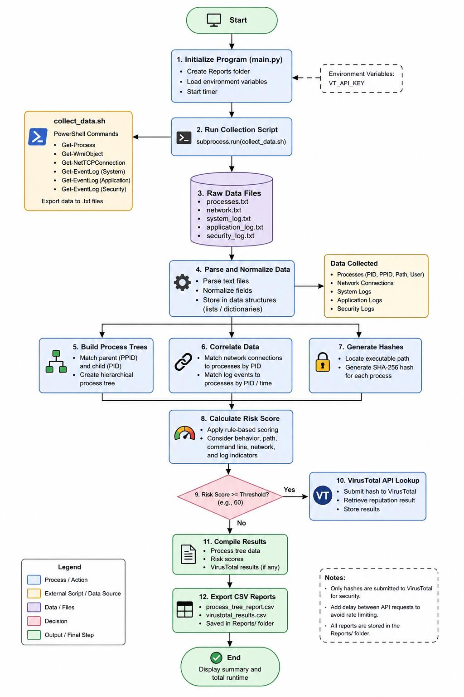
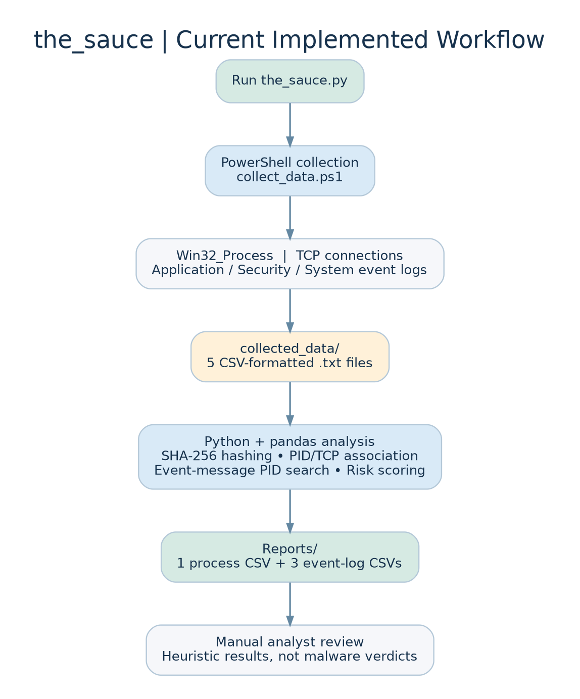

# Software Development Life Cycle — the_sauce

## Project Background

`the_sauce` was originally developed during the Spring 2026 semester as a final project for NET-351 (Python) at Western Iowa Tech Community College (WITCC) in Sioux City, Iowa.

The project was designed to automate the collection, correlation, and analysis of Windows system information to support cybersecurity investigations.

This document is adapted from the original academic Software Development Life Cycle (SDLC) plan and updated to reflect the functionality implemented in version 0.1.0. It distinguishes completed features from the original design objectives and planned future improvements.

## 1. Planning

**Problem:** Security analysts often need to inspect running processes, network connections, and Windows event logs separately. This can make it difficult to identify relationships between system activity and potentially suspicious behavior.

**Project:** `the_sauce`, consisting of the Python analysis script (`the_sauce.py`) and Windows PowerShell collection script (`collect_data.ps1`).

**Objective:** Develop a tool that automates Windows system data collection, correlates selected indicators, calculates heuristic risk scores, and generates CSV reports for security analysis.

**Scope:** Local Windows system analysis using PowerShell for data collection and Python for parsing, hashing, correlation, risk scoring, and report generation.

**Security considerations:** Collected information may contain sensitive usernames, executable paths, command lines, network addresses, and Windows event-log messages. Elevated privileges may be required to access certain information. Generated reports should be stored securely and excluded from public repositories.

## 2. Requirements Analysis

### 2.1 Functional Requirements

**Input sources:**
- Running Windows processes collected through `Get-CimInstance Win32_Process`.
- TCP connections collected through `Get-NetTCPConnection`.
- The latest 100 entries from each of the Windows Application, Security, and System event logs.

**Core functionality:**
- Automated system data collection.
- Process identification using PID and PPID.
- SHA-256 hashing of accessible executable files.
- Correlation of TCP connections with owning process IDs.
- Basic event-log correlation using PID text matching.
- Heuristic risk scoring and classification.
- CSV report generation.

**Output files:**
- `Reports/process_tree_report.csv`
- `Reports/application_log_report.csv`
- `Reports/security_log_report.csv`
- `Reports/system_log_report.csv`

The process report contains PID and PPID information but does not currently generate a hierarchical process-tree visualization.

### 2.2 Non-Functional Requirements

**Performance:** The original project established a target of completing a normal system scan in under five minutes. Actual performance depends on the number of processes, file sizes, and system resources.

**Security:** Sensitive system information must be handled carefully. Collected data and generated reports should not be uploaded to public repositories.

**Compatibility:** The current implementation targets Windows systems with Windows PowerShell 5.1, Python 3, and pandas.

**Scalability:** Version 0.1.0 is designed for local analysis of a single Windows system. Support for larger environments may be considered in future versions.

## 3. Design

### 3.1 System Architecture

The project uses two primary components.

**PowerShell collection layer:** `collect_data.ps1` gathers Windows process information, TCP connection details, and selected event-log records.

**Python analysis layer:** `the_sauce.py` processes the collected data, calculates executable hashes, assigns risk scores, correlates selected information, and exports reports.

The program uses a relatively simple architecture suitable for an early-stage cybersecurity analysis tool.

### 3.2 Data Flow

1. Python creates the `collected_data/` and `Reports/` directories if they do not already exist.
2. Python launches the PowerShell collection script.
3. PowerShell collects process, network, and event-log information.
4. The collected information is written to five CSV-formatted text files.
5. Python loads the collected files using pandas.
6. Accessible executable files are hashed using SHA-256.
7. Processes are assigned heuristic risk scores.
8. Network connections and event IDs are mapped to processes using available PID information.
9. Four CSV reports are exported to the `Reports/` directory.

### 3.3 Original Planned Workflow

The following flowchart was created during the original NET-351 project at Western Iowa Tech Community College. It illustrates the initial design of `the_sauce`, including proposed features such as VirusTotal integration that were not implemented in version 0.1.0.



### 3.4 Current Implemented Workflow

The following diagram illustrates the workflow implemented in version 0.1.0 of `the_sauce`, including Windows data collection, process analysis, SHA-256 hashing, heuristic risk scoring, and CSV report generation.



### 3.5 Risk Scoring Design

The program evaluates selected indicators associated with potentially suspicious process activity.

| Indicator | Risk Points |
|---|---:|
| Executable path contains `temp` or `appdata` | +25 |
| Process name is `powershell.exe`, `cmd.exe`, or `wscript.exe` | +20 |
| Command line contains `-enc` or `encodedcommand` | +30 |
| Process has at least one matching TCP connection | +15 |

Risk classifications are determined using the following thresholds:

| Risk Level | Score |
|---|---|
| Low | 0–29 |
| Medium | 30–59 |
| High | 60 or higher |

These scores are heuristic indicators rather than definitive evidence of malicious activity. Legitimate Windows processes may receive elevated scores.

## 4. Implementation

### 4.1 Development Environment

The original project was developed using Python and Windows PowerShell, with PyCharm identified as the primary development environment and a Windows 10 virtual machine identified for testing.

The current implementation requires Python 3, pandas, and Windows PowerShell with access to the relevant Windows management commands.

### 4.2 Implemented Features

Version 0.1.0 includes:

- Automated Windows process collection.
- TCP connection collection.
- Windows Application, Security, and System event-log collection.
- SHA-256 hashing of accessible executable files.
- Heuristic risk scoring.
- Low, Medium, and High risk classifications.
- PID-based network connection mapping.
- Basic event-log correlation.
- CSV report generation.
- Execution-time measurement.

### 4.3 Features Not Yet Implemented

The original SDLC included several proposed features that are not present in version 0.1.0:

- VirusTotal API integration.
- Hierarchical process-tree generation.
- Sysmon event ingestion.
- JSON report export.
- Graphical user interface.
- MITRE ATT&CK mapping.

These features remain potential future improvements rather than current capabilities.

### 4.4 Implementation Limitations

The current implementation has several technical limitations.

**Event correlation:** Event messages are searched for PID strings. This may produce false matches when unrelated numbers appear in event-log messages.

**Executable hashing:** Files are read into memory before hashing. Large executables may increase memory usage.

**Collection error handling:** The Python script does not currently verify the PowerShell script's exit status. Failed collection may result in incomplete or outdated analysis.

**Access restrictions:** Some executable files and Windows event logs may be inaccessible without sufficient privileges.

**Process-tree representation:** Although the report includes PID and PPID fields, it does not generate a nested or graphical process tree.

## 5. Testing and Verification

### 5.1 Original Testing Plan

The original academic SDLC identified unit, integration, and performance testing as important development activities.

Planned testing included:

- Verifying that Python could launch the PowerShell collection script.
- Confirming that collected files could be parsed correctly.
- Validating SHA-256 hash calculations.
- Checking risk scores against known sample inputs.
- Confirming directory creation and CSV exports.
- Testing process and network correlation.
- Measuring execution time.

The original plan also included testing VirusTotal integration, but that functionality was not implemented in version 0.1.0.

### 5.2 Current Verification Status

The available source code establishes the implemented functionality but does not independently verify that every test described in the original SDLC was completed.

Future development should include automated tests and documented results.

### 5.3 Recommended Additional Testing

Recommended validation includes:

- Successful and failed PowerShell collection.
- Missing or malformed input files.
- Permission-denied errors when accessing executables.
- Accuracy of SHA-256 hashes.
- Expected risk scores for controlled sample processes.
- Network connections associated with known process IDs.
- False-positive event-log correlations.
- Behavior when Windows event logs are inaccessible.
- Performance when processing large executable files.

## 6. Deployment

### 6.1 Installation Requirements

The tool requires:

- A compatible Windows operating system.
- Windows PowerShell 5.1 and the necessary Windows management cmdlets.
- Python 3.
- The pandas Python package.

Administrator privileges are recommended and may be necessary for accessing protected Windows information.

### 6.2 Installation

Download or clone the GitHub repository and keep `the_sauce.py` and `collect_data.ps1` in the same directory.

Install the required Python dependency:

```powershell
python -m pip install -r requirements.txt
```

### 6.3 Execution

Open Windows PowerShell, navigate to the repository directory, and execute:

```powershell
python the_sauce.py
```

The Python program launches the PowerShell collection script, processes the resulting data, and exports reports.

### 6.4 Generated Files

The `collected_data/` directory contains intermediate data files:

- `processes.txt`
- `network.txt`
- `application_log.txt`
- `security_log.txt`
- `system_log.txt`

The `Reports/` directory contains the four exported CSV reports.

Both directories may contain sensitive system information and should remain excluded from Git version control.

### 6.5 Security and Usage Considerations

The tool is intended for educational, research, and authorized defensive security purposes.

Users should obtain appropriate authorization before collecting system information, protect generated reports, and independently verify suspicious findings.

The software is provided under the MIT License, without warranties of any kind.

## 7. Maintenance and Future Development

Future development will focus on improving reliability, accuracy, performance, and usability.

### 7.1 Reliability and Error Handling

- Verify PowerShell collection success before analyzing data.
- Improve handling of missing or malformed files.
- Provide clearer error messages and execution logs.
- Prevent outdated collection files from being mistaken for current scan results.

### 7.2 Performance Improvements

- Implement chunked SHA-256 hashing to reduce memory consumption.
- Optimize process and event-log correlation.
- Evaluate performance on systems with larger numbers of processes.

### 7.3 Security Analysis Improvements

- Replace PID substring matching with more reliable event correlation.
- Improve risk-scoring rules and reduce false positives.
- Consider optional VirusTotal hash lookups.
- Investigate Sysmon integration and MITRE ATT&CK mapping.

### 7.4 Reporting and Interface Improvements

- Add JSON export capabilities.
- Develop a hierarchical process-tree representation.
- Consider a graphical interface.
- Improve report readability and filtering.

### 7.5 Version Control and Documentation

The project is maintained through GitHub, with source-code changes tracked through commits and versioned releases.

Version 0.1.0 represents the initial documented development release. Future releases should include updated documentation, testing results, and release notes describing implemented changes.

---

## License

`the_sauce` is distributed under the MIT License. See the [LICENSE](../LICENSE) file for the complete license terms.
